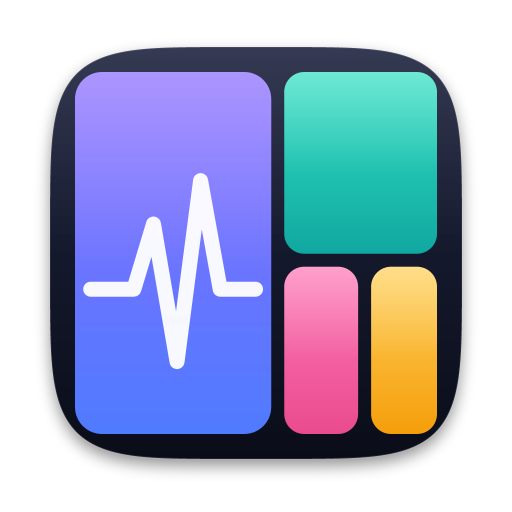
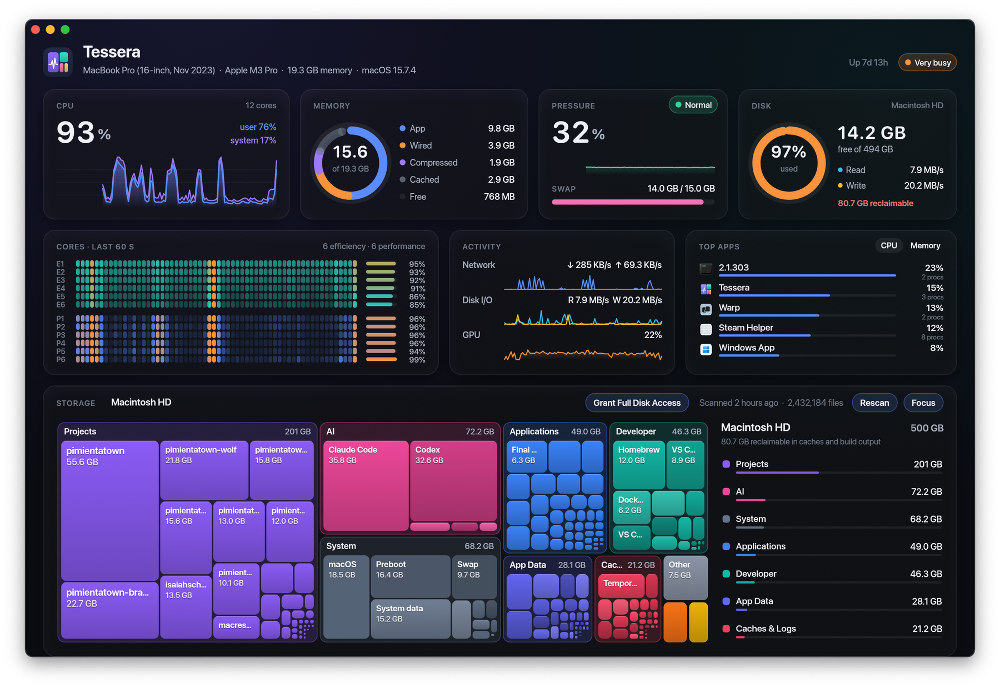
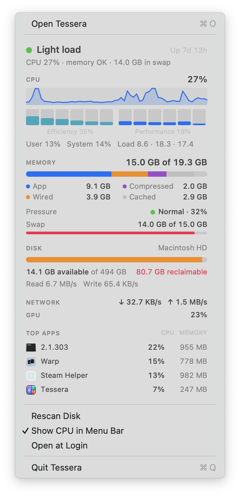
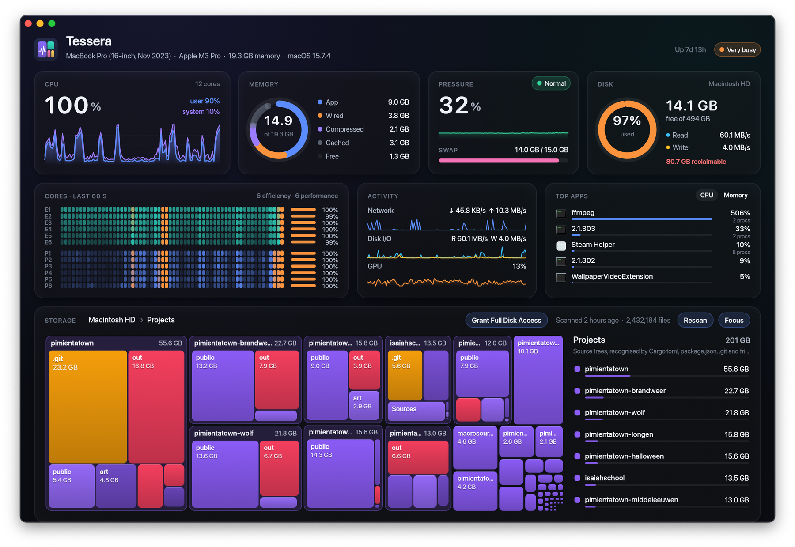
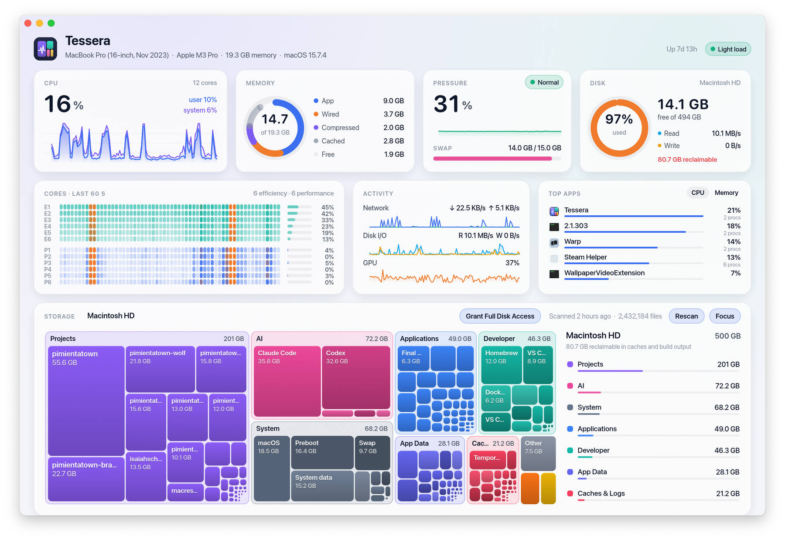

<p align="center">
  
</p>

<h1 align="center">Tessera</h1>

<p align="center">
  A macOS menu bar resource monitor and disk map, written in Rust.
</p>

Tessera puts a small mosaic icon in the menu bar. Click it for a live
read-out of how busy your Mac is. Open the app for a full dashboard: live CPU
(overall and per core), memory and memory pressure, swap, disk, network and
GPU, plus an interactive map of what is taking up your disk.

<p align="center">
  
</p>

## Features

**Menu bar dropdown** (native `NSMenu`, opens instantly)

- *Open Tessera* as the first item
- Overall activity in one word (Idle, Light load, Busy, Very busy,
  Memory critical) with a one-line summary
- CPU: total %, 60-second sparkline, a bar per core (efficiency and
  performance clusters shown separately), user/system split, load average
- Memory: used of total, broken down into app, wired, compressed and cached
  memory, with pressure level and swap usage
- Disk: used and available space, read/write throughput, and how much space
  is reclaimable
- Network throughput and GPU load
- Top apps by CPU, with their icons and memory use (helper processes are
  grouped under their app)
- Rescan Disk, Show CPU in Menu Bar (live percentage next to the icon), Open
  at Login, Quit

<p align="center">
  
</p>

**Dashboard window**

- Live cards for CPU, memory (ring breakdown), memory pressure and swap,
  and disk, each with history charts
- A per-core heatmap of the last 60 seconds, efficiency and performance
  cores grouped
- Network, disk I/O and GPU activity charts; top apps by CPU or memory
- **Disk map**: a squarified treemap where each block is something you
  recognise (an app, a project, a toolchain, a media library), grouped
  into Applications, Projects, Developer, AI, Media, Documents, App Data,
  Caches & Logs, Trash, System and Other
  - Click a block to zoom one level deeper (a category, then an item, then
    folders all the way down), with a zoom animation from the clicked tile
  - Breadcrumbs, <kbd>Esc</kbd>, <kbd>⌘↑</kbd> or the mouse back button go
    back up
  - Hover for details: size, share of parent, file count, last modified,
    project language, reclaimable space
  - Right-click for *Reveal in Finder*, *Open*, *Copy Path*
  - Projects are detected from `Cargo.toml`, `package.json`, `.git`,
    `go.mod`, `pyproject.toml`, Xcode projects, Godot, Unity, Unreal and
    more. Build output (`node_modules`, `target`, `.venv`, DerivedData, …)
    is marked as reclaimable.
  - *Focus* hides the vitals so the map can use the whole window
- Follows the system light/dark appearance; the Dock icon only appears
  while the window is open

<p align="center">
  
  <br><em>Zoomed into Projects: each project broken down into its <code>.git</code> history, build output and folders</em>
</p>

<p align="center">
  
  <br><em>Light appearance</em>
</p>

## The disk index

Walking a whole disk takes time, so Tessera keeps a small index and does not
re-walk the disk every time you open the window:

- The scanner reads directories in bulk with `getattrlistbulk(2)` (one
  syscall per batch of entries instead of one per file) across a pool of
  threads. On an M3 Pro it maps ~2.2 million files / 420 GB in about
  10–16 seconds, and a 480k-file folder in under 2 seconds.
- Only entries that matter are kept: folders of at least 1 MB, files of
  at least 8 MB, at most 400 children per folder. Everything smaller is
  added into its parent's total, so sizes stay exact while the index stays
  tiny: about **1.3 MB for 38k nodes**, and it loads in a few milliseconds.
- Sizes are allocated bytes (what the files actually occupy on disk).
  Hard links are counted once. Evicted iCloud/File Provider placeholders
  are not downloaded.
- The index is stored at `~/Library/Application Support/Tessera/disk-index.bin`.
  The first scan runs at user-initiated priority. After that, Tessera rescans
  in the background at utility priority every 6 hours, or when you choose
  *Rescan*.
- The APFS volumes that are not scanned (the sealed macOS system volume,
  swap on the VM volume, Preboot) are read with `getattrlist` and shown
  as their own blocks. Space that nobody can see (snapshots, unreadable
  folders) shows up as *Hidden space*, so the map adds up to what the disk
  reports.

## Overhead

Measured on an M3 Pro (12 cores, 2.2 million files):

| | CPU | Memory |
| --- | --- | --- |
| In the menu bar (most of the time) | ~0.2% of one core | ~45 MB |
| Dashboard open, mouse moving over it | 15–20% of one core | grows by the window's GPU buffers |
| Disk rescan (every 6 hours, ~10 s) | ~17 s of CPU in total, at utility priority | back to ~45 MB afterwards |

- A full metrics sample takes about 0.25 ms. Per-app usage is sampled
  every 8 seconds unless the dropdown or dashboard is open.
- While the dashboard is open it redraws once a second, and on every mouse
  movement. A frame costs about 0.5 ms of CPU to lay out.
- macOS keeps the window's GPU buffers (tens of MB, more on large displays)
  after you close the dashboard, until Tessera quits.
- On disk: 9.6 MB for the app and 1.3 MB for the index.

## Install

Requirements: macOS 13 or later, Xcode Command Line Tools
(`xcode-select --install`) and [Rust](https://rustup.rs). The repository
pins its Rust version in `rust-toolchain.toml`, so `rustup` downloads the
right compiler on the first build.

```sh
git clone https://github.com/gbvanrenswoude/macresourcevisualisator.git
cd macresourcevisualisator
make install
```

`make install` (which runs `scripts/install.sh`) does the following:

1. builds a release binary with `cargo`
2. assembles `target/Tessera.app` with its icon and `Info.plist`
3. signs it with your *Apple Development* / *Developer ID* certificate if
   you have one in the keychain, otherwise ad-hoc
4. copies it to `/Applications` (or `~/Applications` if that is not
   writable) and launches it

The mosaic icon then appears in the menu bar and the dashboard opens.

### First launch

- **The first disk scan starts right away** and takes a few seconds to a
  minute, depending on how many files you have. During it, macOS asks
  whether Tessera may access your Desktop, Documents and Downloads folders
  and *data from other apps*. Allow them for a complete map. Folders you
  decline show up as *Hidden space*.
- **Full Disk Access (recommended).** Some data (Mail, Messages, Safari,
  some app containers) is only readable with Full Disk Access. Open
  *System Settings → Privacy & Security → Full Disk Access*, add Tessera,
  then choose *Rescan Disk*. The dashboard shows a *Grant Full Disk
  Access* button while access is missing. With access granted, the
  folder prompts above no longer appear.
- **Open at Login.** Turn it on from the menu bar dropdown (it uses macOS's
  standard login item, listed under *System Settings → General → Login
  Items*).
- Closing the window (<kbd>⌘W</kbd> or the red button) keeps Tessera running
  in the menu bar. Quit from the dropdown, or with <kbd>⌘Q</kbd> while the
  window is focused.

### Updating and uninstalling

```sh
git pull && make install                      # update in place
rm -rf /Applications/Tessera.app              # uninstall
rm -rf ~/Library/Application\ Support/Tessera # remove index, settings, window state
```

To run a build on another Mac, copy `Tessera.app` over and right-click
*Open* the first time. The app is signed but not notarized, so Gatekeeper
asks before opening copies that came from another machine or the internet.

## Development

```sh
make run      # debug build, straight from source
make test     # unit tests (metrics, scanner, index, treemap, formatting)
make icons    # re-render the icon and menu bar glyph from code
make app      # just build target/Tessera.app
```

Useful environment variables while developing:

| Variable | Effect |
| --- | --- |
| `TESSERA_SCAN_ROOT=~/projects` | Scan one folder instead of the whole volume |
| `TESSERA_DATA_DIR=/tmp/tessera` | Keep the index and settings somewhere else |
| `TESSERA_EXCLUDE=/path/a:/path/b` | Leave folders out of the scan |
| `TESSERA_SCREENSHOT=/tmp/dash.png` | Render the dashboard to a PNG and quit |
| `TESSERA_THEME=dark` / `light` | Force an appearance (dashboard, window frame and dropdown) |
| `TESSERA_OPEN=projects` | Open the disk map at a category (or `projects:/path`) |
| `TESSERA_SHOW_AFTER=5` | Start hidden, then open the dashboard like the menu item does |
| `TESSERA_MENU_SNAPSHOT=/tmp/menu.png` | Render the dropdown's stats view to a PNG |
| `TESSERA_OPEN_MENU=5` | Open the dropdown after that many seconds, as if clicked |
| `TESSERA_CAPTURE=/tmp/shots` | Save the open dropdown, and the dashboard's window frame, as PNGs (no screen-recording permission needed) |

`cargo run --release -p tessera-core --example scan -- ~/projects` scans a
folder from the command line and prints the overview, which helps when
tuning the classification rules.

### Layout

```
crates/
  tessera-core/   metrics sampling (Mach, sysctl, IOKit, libproc),
                  scanner, index, semantic overview, treemap layout
  tessera/        the app: menu bar item (objc2 / AppKit) and the dashboard
                  window (egui / eframe on wgpu / Metal)
  tessera-icon/   renders the app icon and menu bar glyph (tiny-skia)
assets/           generated icon and glyph
docs/screenshots/ README images
packaging/        Info.plist template
scripts/          build-app.sh, install.sh
```

Where the numbers come from:

| Metric | Source |
| --- | --- |
| CPU per core | `host_processor_info(PROCESSOR_CPU_LOAD_INFO)` |
| Core types | `IODeviceTree:/cpus` `cluster-type` (E/P) |
| Memory | `host_statistics64(HOST_VM_INFO64)`, Activity Monitor's formulas |
| Memory pressure | `kern.memorystatus_vm_pressure_level`, `kern.memorystatus_level` |
| Swap | `vm.swapusage` |
| Disk space | `NSURLVolumeAvailableCapacityForImportantUsageKey` (includes purgeable space, like Finder) |
| Disk I/O | IOKit `IOBlockStorageDriver` statistics |
| Network | `NET_RT_IFLIST2` 64-bit interface counters |
| GPU | IOKit `IOAccelerator` performance statistics |
| Apps | `proc_listallpids` + `proc_pid_rusage`, grouped by `.app` bundle |
